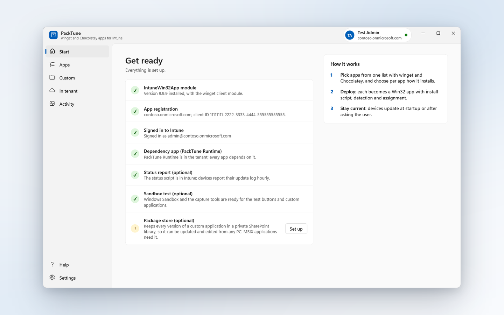
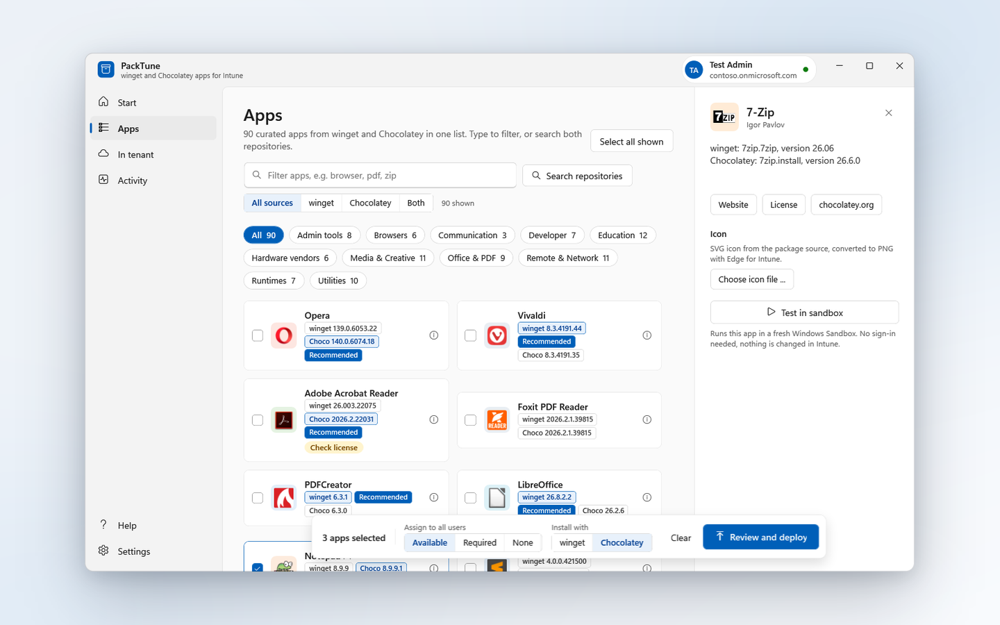
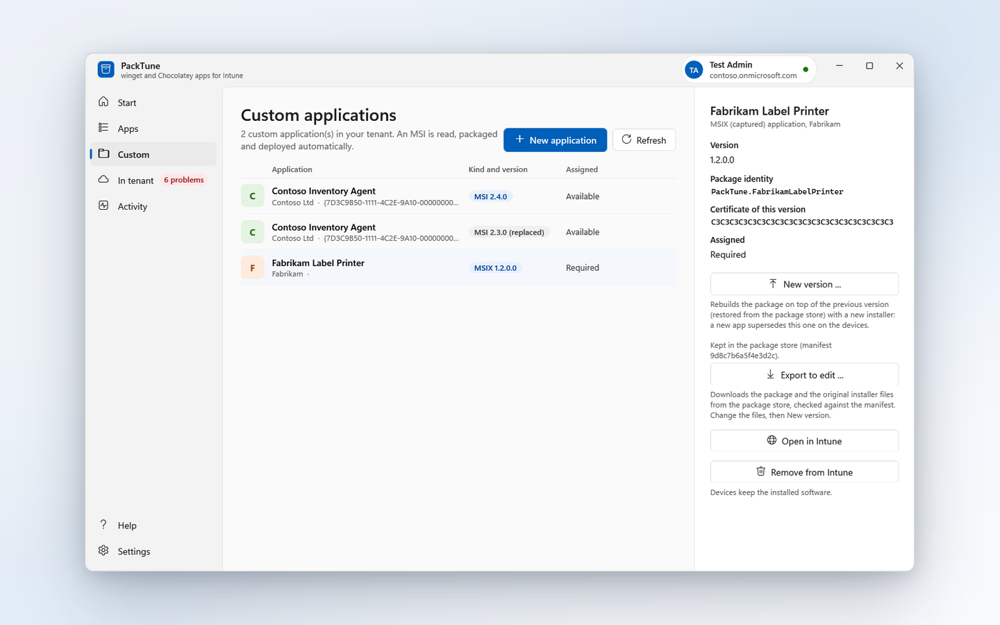
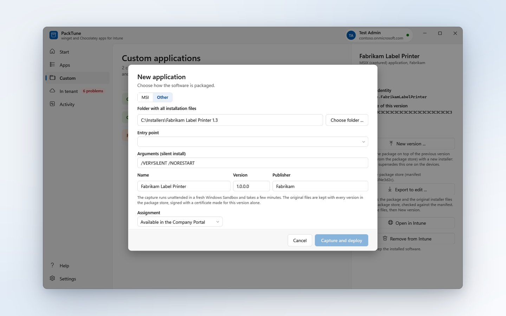
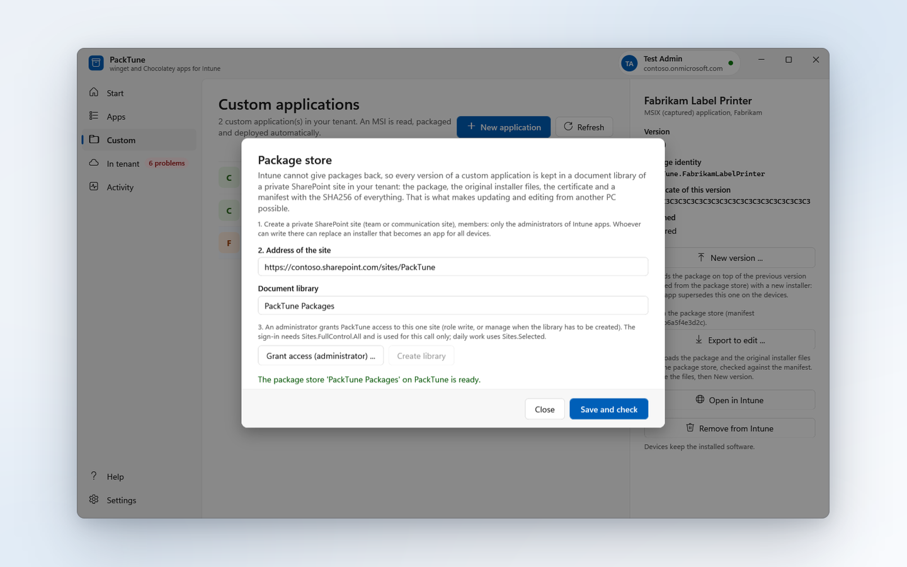
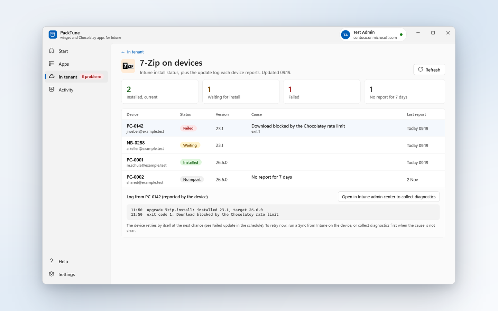
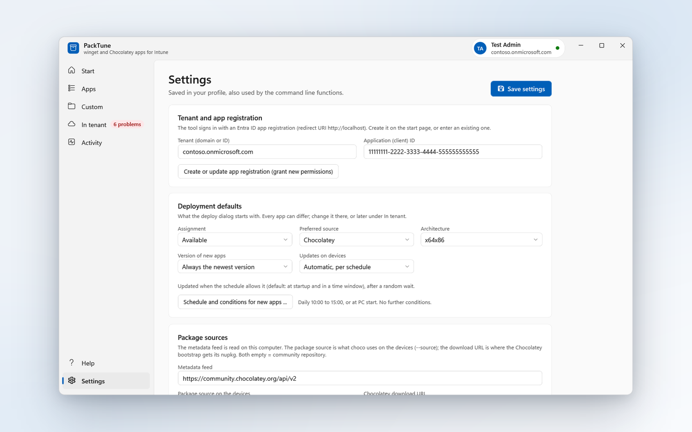

# PackTune

**winget and Chocolatey apps for Intune.** Publish winget and Chocolatey apps to Microsoft Intune as Win32 apps, keep them up to date on the devices, and see what happened on each device.


## What it does

- **One app list** for Chocolatey and winget. For each app the tool shows both versions and recommends the source with the newer one.
- **Deploys** each app as an Intune Win32 app with install script, detection rule, dependency app and assignment (Available, Required or None).
- **Keeps devices current** with a per-app update mode: Off, Automatic per schedule, or Ask the user with a grace period. Versions are either always the newest or pinned.
- **Releases new versions** from the tool: Required apps are updated in place, Available apps get a new app that supersedes the old one.
- **Shows the status** of every app: install status per device, the update log each device reports, and the cause of failures. It also imports apps that already exist in a tenant and tests packages in Windows Sandbox.

## Requirements

- Admin machine: Windows 10 or Windows 11. The graphical interface runs in Windows PowerShell 5.1; the command line works in Windows PowerShell 5.1 and PowerShell 7.
- The PowerShell module [IntuneWin32App](https://github.com/MSEndpointMgr/IntuneWin32App) 1.5.0 or newer, and `Microsoft.WinGet.Client` for winget. `Install-PackTuneComponents` installs both for the current user.
- Chocolatey and Inkscape are **not** needed on the admin machine: package infos and icons come from the chocolatey.org feed, SVG icons are converted with Microsoft Edge.
- An Entra ID app registration with these delegated Microsoft Graph permissions and admin consent:
  - `DeviceManagementApps.ReadWrite.All`
  - `DeviceManagementConfiguration.ReadWrite.All`
  - `DeviceManagementRBAC.Read.All`
  - `Group.Read.All`
  - `DeviceManagementManagedDevices.Read.All` (install status and device logs in *In tenant*)

### Install

1. Download the repository and keep it together, for example in `C:\admin`.
2. Install the modules once (no admin rights needed):
   ```powershell
   . C:\admin\PackTune-Main.ps1
   Install-PackTuneComponents
   ```
3. Start the graphical interface with **Start.cmd** and follow the *Start* page (see below). It creates the app registration for you. By hand, the registration is:
   - Entra admin center > App registrations > New registration, any name (the tool uses "PackTune"; a registration of the earlier name "Intune Chocolatey Deployment" is recognized and reused when you are its only owner)
   - Authentication > Add a platform > Mobile and desktop applications > Redirect URI `http://localhost`
   - API permissions > Microsoft Graph > Delegated: the five permissions above, then grant admin consent
   - Note the Application (client) ID and the tenant

Sign-in opens Microsoft's own sign-in in a window of the tool (Edge WebView2, which is part of Windows 11); the app registration setup uses the same window. If the WebView2 runtime is missing or the window cannot start, the tool says so and uses the web browser instead. **Sign in in the web browser** in the sign-in menu forces the browser, e.g. when your organization requires a compliant or joined device. Optionally you can sign in with an account from [Keevault](https://keevault.de) (requires *AI agents (MCP)* switched on in Keevault).

## Using the tool

Start the interface with **Start.cmd** (or `powershell.exe -ExecutionPolicy Bypass -File C:\admin\Start-PackTune.ps1`). Apps from **winget** and **Chocolatey** are in one list; you choose the source per app when you deploy. The **Help** entry in the navigation explains each page.

### Start



The readiness list checks the IntuneWin32App module, the app registration, the sign-in, the dependency app (PackTune Runtime) in the tenant and, as optional items, the status report and the sandbox test. The sandbox item checks for Windows Sandbox (not available on Windows Home; Install asks for administrator approval and needs a restart, and Set up everything never installs it) and for the capture tools (Microsoft's MSIX Packaging Tool and signing tools, downloaded on first use or with **Download now**, checked against Microsoft's signature and a hash list); without Windows Sandbox the Test buttons are disabled and say why. Nothing else has to be installed: the sandbox functions are part of PackTune (`Modules\PackTune.Sandbox.psm1` and the scripts in `Sandbox\`). A red item says why and has the button that fixes it. **Set up everything** runs all fixes one after another.

### Apps



One list for both sources: the curated list in `catalog.json`, the 200 most downloaded Chocolatey packages, and the apps you added yourself.

- **Source filter**: All sources, winget, Chocolatey, or Both (apps available from both).
- **Recommended** marks the source with the higher version. Equal or unknown versions give no recommendation.
- **Popular** (filter chip): the top 200 Chocolatey packages by download count, read with one small paged query of the community feed (cached for 24 hours; the feed answers with versions, so no lookup per package). A winget package is shown for one of them only when it clearly is the same product (same name, and the publisher appears in the package); otherwise it stays Chocolatey only. Infrastructure and library packages, deprecated packages, `x.install` next to `x`, and apps the curated list has are left out. The category comes from the package tags, or "Other". **Most downloaded** sorts by relevance.
- **Add application** opens a search of winget and Chocolatey while you type (most downloaded first, with icon, sources, versions and the Recommended tag). **Add** puts the app into **My apps** (`%LOCALAPPDATA%\PackTune\my-apps.json`: names and package ids only); **Remove from my apps** in the details takes it off again without touching Intune.
- **Refresh versions** reads the infos of all listed apps and the popular list again now, ignoring the cache; the feed is asked slowly and retried with a wait when it limits the requests. The same refresh runs in the background at every start, but not more often than once an hour; the list shows the cached data at once and updates in place ("Updating versions 120/290").
- **Search repositories** searches the whole Chocolatey community repository or winget.
- Select several apps (Ctrl or Shift click), choose the assignment, the install source and **Review and deploy**. The details panel shows links, a license note where one is known, a custom icon (PNG, JPEG, SVG, ICO) and **Test in sandbox** (see below).

### Custom applications

Custom applications need the **package store** (the PackTune site, see below): without a ready store the page shows *Set up the package store first* with a **Set up** button, and **New application**, **New version** and **Export** are off (MSI and Other alike), so the state of an application is always kept somewhere. Existing applications are still listed and can be removed. A created or removed app shows up in the lists at once (inserted from the create response, kept until Graph lists it, at most two minutes; the In tenant badge of the catalog follows).



Your own software next to the catalog apps, as Win32 apps in Intune. **New application** asks what you have:

- **MSI**: fully automatic. PackTune reads the MSI without installing it (product code, name, version, manufacturer, upgrade code), builds the package with silent `msiexec` scripts (install as SYSTEM inside the device lock, remove by product code) and detects the app by product code and version. Extra public properties (`ALLUSERS=1 INSTALLDIR=...`) are passed to msiexec. **Test in sandbox** runs exactly these scripts in Windows Sandbox.
- **Other** (EXE setups, scripts, several files): put ALL installation files into one folder and choose the entry point and the silent arguments. PackTune captures an MSIX from it automatically in a fresh Windows Sandbox (needs Windows Sandbox; Microsoft's capture tools are downloaded on first use), signs it on this PC with a certificate made for this version alone (non-exportable key, deleted right after signing, never stored) and delivers it as **one** Win32 app: the package holds the MSIX and the public certificate of that version; `install.ps1` (SYSTEM) puts the certificate into `LocalMachine\TrustedPeople` and provisions the MSIX for all users. The publisher stays `CN=PackTune <name>` for every version, so updates keep the identity. A failed update puts the earlier version back and keeps its certificate; uninstall removes only the certificate of that version.
- **New version**: for an MSI a newer MSI of the same product (new product code); for an MSIX application the previous MSIX is restored from the package store in a fresh sandbox, the new installer (or the stored, possibly edited, files) runs on top, and the result goes out as a new version. Both create a new app that supersedes the old one (type update, assignments copied, auto-update for Available apps); **Remove-PackTuneSupersededApps** removes old versions no device has any more.
- **Export to edit** downloads one version (package, original installer files, certificate, recipe, documentation) from the package store, checked against the manifest. Change the files, then **New version** with that folder.
- **Remove from Intune** asks whether the stored files go too (SharePoint keeps them in its recycle bin). Devices keep the installed software.



**Package store.** Intune cannot give content back, so every version is kept in the document library `PackTune Packages` of a private SharePoint site: `<app id>/<version>/` with `package.msix` or `package.intunewin`, `installer.zip` (the original installer files, always), `recipe.json`, `signing.cer`, `documentation.zip` and `manifest.json` (SHA256 of everything, written last). The store is the **same standard site in every tenant**, so other Intune administrators find it without any input: the private site `PackTune` (`https://<tenant>.sharepoint.com/sites/PackTune`, the tenant is taken from the initial domain) with the library `PackTune Packages`. On every start PackTune looks for it and uses it when it is there and reachable. If it exists but you cannot read it, the Start page says *Ask an administrator to add you to the PackTune site*; if it does not exist, an administrator sets it up once with **Set up** (the address field is under *Advanced*, only for a different site). Set up makes a private Microsoft 365 group `PackTune` (hidden in Outlook and the address lists, no welcome mail, you as owner, optionally an Entra group such as your Intune administrators as member; only Intune administrators belong there, because whoever can write there could replace an installer that becomes an app for all devices), waits until Microsoft 365 has made its site (polling with a growing pause), creates the library and gives PackTune's app registration the role `write` on that one site (`Sites.Selected`). If a group with that mail nickname exists that PackTune did not make, nothing is changed and PackTune offers the name `PackTune-Packages` instead (remembered). The setup sign-in goes through Microsoft's app *Microsoft Graph Command Line Tools* and asks for `Sites.FullControl.All` and `Group.ReadWrite.All`; PackTune uses them for this setup only, daily work uses the delegated `Sites.Selected`. The consent given there **stays in the tenant** afterwards (PackTune does not remove it: other tools may use that app). Remove it when it is not needed any more: Entra admin center > Enterprise applications > Microsoft Graph Command Line Tools > Permissions (Admin consent and User consent) > Revoke, or with Microsoft Graph PowerShell `Remove-MgOauth2PermissionGrant` (or `Update-MgOauth2PermissionGrant` without these two permissions in its scope). The full SHA256 of the manifest is written into the notes of every Intune app (`manifest=`), so an export or an update refuses files that do not match what was packaged, and refuses as well when the notes carry no manifest (fail closed). When the store was changed on purpose, an administrator checks what is in it with `Get-PackTuneCustomAnchorReport -Id <Intune app id>` and records it with `Set-PackTuneCustomManifestAnchor -Id <id> -StoreManifest <hash from the report>` (asks for confirmation; apps of the first release with the short 16-character anchor still work and should be re-anchored the same way). MSIX applications need the store; MSI applications use it when it is set up. Requirement for the capture: Windows Sandbox (readiness item on the Start page).


### Test in sandbox

A fresh Windows Sandbox plays the package through the paths Intune takes, as SYSTEM, and reports the result back to the Activity job and a toast:

1. **Detect before the install**: expected not detected. If it is detected, the lab says so ("Intune would skip the install") and stops.
2. **Install**, then **detect**: expected a success code, then detected.
3. With a previous version (`Test-PackTunePackage -FromVersion`, `Test-PackTuneCustomApp -PreviousMsiPath`): the previous version is installed and detected first, then the update and its detection (the update path).
4. **Uninstall**, then **detect**: expected a success code, then not detected.

Every step shows exit code, duration, expected and actual. The buttons per step stay in the lab window, **Run all steps** plays them in order and stops at the first unexpected result. Started from PackTune the lab runs by itself (`-AutoRun`); the summary is Passed, or Failed at step N with the cause.

### Review and deploy


- **Install with**: the source per app. The default is the recommended source, else the preferred source from the settings.
- **Assignment**: Available (in the Company Portal), Required (installed on the devices) or None.
- **Updates on devices** and **Version on devices**: always the newest version, or one pinned version.
- Every app depends on the one PackTune Runtime app (Chocolatey and winget for SYSTEM); it is created first when it is missing.

Deployments run in the background, one after another (see *Activity*).

### In tenant


Lists the apps this tool created, plus the PackTune Runtime dependency app (and the two older dependency apps, Chocolatey and winget runtime, while a tenant still has them). When apps still depend on the old apps, a banner offers **Switch to PackTune Runtime** (after a confirmation, as a job); once nothing depends on an old dependency app, **Remove old dependency apps** deletes it, again only on request. Select an app to change its settings below the list:

- **Version on devices** (newest or pinned) and **How devices update** (Off, Automatic, or Ask the user, then install).
- **When updates install** shows the schedule summary; **Advanced** opens the schedule (see *Update schedule*).
- **Apply in Intune** writes the new policy. Devices take it at their next Intune check.
- **Release**: a pinned app with a newer version offers the release. Required apps are changed in place. Available apps get a new app that supersedes the old one, with auto-update of superseded apps on.
- **Clean up**: removes superseded apps once no device reports them as installed any more.
- **Devices** opens the status of the app (see *Status*). **Remove from Intune** removes only apps this tool created; Chocolatey stays while other apps depend on it.

### Update schedule


Opened from an app (**This app**) or for new apps (**Default for new apps**). The schedule decides when an *Automatic* app updates and under which conditions.

- **Install updates**: at PC start (after a random wait), in a time window (daily at a random time, on the chosen weekdays; it may cross midnight), when the PC was idle for 1, 5, 10, 15, 30 or 60 minutes, or at user sign-in.
- **Only if**: the PC runs on mains power, no presentation or full-screen app is running, the network is not metered, the app is not running.
- **Advanced**: spread over devices, how often to look for new versions (1, 4 or 24 hours; default every hour), the deadline for *Ask the user, then install* (default 2 days), what happens when the app is open at the deadline (install anyway, warn and close, close, or wait), restart handling, retries after a failed update, and process names for "app is running".

Update modes:

| Mode | Behaviour on the device |
|------|-------------------------|
| **Off** | No automatic updates. A released version is installed right away; a settings change alone never upgrades a latest app. |
| **Automatic** (`Startup`) | Per schedule. Default: at PC start and once a day between 10:00 and 15:00. |
| **Ask the user, then install** (`Custom`, the default for new apps) | Checked at startup and every hour. The tray agent shows the update in its popup (see below); the user can install now or postpone 2 days. After the grace period (default 2 days) it is installed without waiting for a restart. Existing apps keep their mode. |

**Tray agent "PackTune Updates".** The PackTune Runtime puts a small agent on every device (`tray.ps1` in the protected folder, started at every sign-in by a task of the Users group, hidden, no admin rights, no network; the task is set to run in parallel, so every user who signs in gets an agent, also on multi-session hosts, and the agent's own per-session mutex keeps it to one per session. A logon trigger of a group principal fires for each user who signs in; a second interactive session cannot be built in Windows Sandbox, so this part is reasoned, not run live). A tray icon shows three states (up to date / updates available / installing). A click opens a popup in the PackTune look, bottom right above the tray: the pending updates of apps in the mode *Ask the user, then install* with app icon, name and `installed -> new`, per app **Install now** and **Postpone 2 days** (with the text *Installs automatically on <date>*; the deadline itself belongs to the system and cannot be moved, a postponement ends at the latest one hour before it), **Install all now**, and the installs that run or just finished. The popup also opens by itself when a NEW update becomes pending (once per app and version). Apps in the modes Automatic or Off do not ask, the tray only shows when they are updating. The agent reads the protected per-app folders read only; *Install now* starts the existing SYSTEM task `Update <package> now` after the same validation as the toast buttons (package installed with a policy, update pending), *Postpone* only writes a snooze file of the user. While the agent runs it replaces the update prompts of the single apps; the toasts below stay as the fallback when it is not running. `Tests\Check-Tray.ps1` checks the state machine and the action mapping, `Tests\Spike-Tray.ps1` shows the popup live in Windows Sandbox.

**Notifications on the device.** The prompts (update available, restart needed, the app will be closed at the deadline, result) are native Windows toasts under the app **PackTune Updates**, with the icon of the package, in the Notification Center: *Install now* / *Later*, *Restart now* / *Remind me in 1 hour*. Deadline notices use the reminder scenario and stay on screen. The buttons use the protocol `packtune-update:` (registered in the user's own registry by the notification task) and only map to these fixed actions: every toast carries a one-time token that was written when it was shown, the address must match exactly, the package must be installed with a policy in the protected folder, and anything else is ignored, so a web page can neither trigger nor learn anything. When toasts are switched off, or Focus assist or a presentation hides a deadline notice, a small PackTune window with the same buttons opens instead. Problems are written to `%LOCALAPPDATA%\PackTune\Updates\notify.log`. `Tests\Check-Toast.ps1` checks the XML, the action mapping and the routes; `Tests\Spike-Toast.ps1` shows the toasts live in Windows Sandbox.

Changes take effect without redeploying: the device's detection compares a fingerprint of the policy and runs `install.ps1` again when it changed (see *What gets deployed*). Apps created by older versions count as latest and Automatic until you change them.

### Status



Opened with **Devices** on an app in *In tenant*.

- **Counts and rows**: installed and current, waiting for install, failed, and no report for 7 days, with one row per device (status, version, cause, last report). The install status comes from Intune.
- **Device log**: each device writes the result of its last attempt (`last-result.json`) and its update log. The status report is a Remediations detection script that Intune runs on all devices every hour; it lists failed apps first with their cause. **Set up status report** creates it.
- **Licensing**: Remediations need Windows Enterprise E3/E5 (Microsoft 365 F3/E3/E5), Education A3/A5, or Windows VDA per user. Without them the page switches by itself to **Status from Intune's install report** (Intune P1 is enough, e.g. Business Premium): one row per device, failed first, with the cause taken from the exit code of `install.ps1` that Intune reports (see [Exit codes](#exit-codes-of-the-device-scripts)). What is missing then: the history and the last successful update of each device, because only Remediations read the device log. The page says so in one line.
- **Causes** are short texts for common exit and error codes from the documented Windows, winget and Intune codes. The mapping is not verified against a live tenant.
- **Full log**: **Open in Intune admin center to collect diagnostics** opens the device. Run *Collect diagnostics* there, download the package, and look for `PackTune-<package>.log` (`IntuneChocoDeployment-<package>.log` on devices that did not run the new scripts yet) in the `IntuneManagementExtension\Logs` folder.

### Import


The tool keeps no local database: all state is in the Intune apps (the notes of each app). Import brings in apps from three places:

- **This tenant**: Win32 apps that already install with Chocolatey or winget and are not managed yet. *Take over* writes the tool's notes (package and update policy) into the app. Content, detection and assignments stay as they are, and devices notice nothing; the new device scripts come with the next settings change.
- **Another tenant**: a read-only sign-in with that tenant's own app registration (`DeviceManagementApps.Read.All`). The apps are created here, with assignment None by default.
- **Export file**: *Export managed apps* writes a JSON file with name, package, version, update mode and feed. It holds no tenant or app IDs and no secrets. Importing it creates the apps here.

A package source offered by an import is used only when it is an https URL without user name, password or query, and only after you confirm it for each app.

### Activity


Deployments run one after another in the background, and the window stays usable. *Show log* shows the steps of one job. Every step is also written to a log file per day in `%LOCALAPPDATA%\PackTune\logs` (button *Open log files*).

### Settings



- **Tenant and app registration**: tenant (domain or ID) and client ID. *Create or update app registration* runs the setup again, adds missing permissions and the admin consent.
- **Deployment defaults**: assignment, preferred source, architecture, version, update mode and the default schedule for new apps.
- **Package sources**: the metadata feed (read on this computer), the package source used on the devices (`choco --source`), and the download URL of the Chocolatey bootstrap. Empty = the community repository.
- **Repositories**: custom applications from GitHub repositories (public without a sign-in, private with a read token, any number of them). Apps show the source "Repository: <name>"; every new version needs your approval (commit, author, signature, file hashes shown) before **Deploy to Intune**; **Move to repository** copies an app with all versions from the package store, verifies it and keeps SharePoint unless you confirm the removal. Guide, layout and template repository: [docs/REPOSITORIES.md](docs/REPOSITORIES.md).
- Module installation and the work folder.

Settings are saved in `%LOCALAPPDATA%\PackTune\settings.json` and are also used by the command line functions. On the first start after the rename they are copied (not moved) from `%LOCALAPPDATA%\IntuneChocoDeployment`, together with the feed and icon caches. Package infos are cached for 24 hours; SVG icons are rendered once with Edge and kept in the work folder.

## What gets deployed on devices

Each app is one Win32 app in Intune with:

- **Install command**: `install.ps1` (as SYSTEM, in 64-bit PowerShell) with the policy baked in. Uninstall runs the same script with `-Uninstall`.
- **Detection**: a script that checks the installed package and the policy fingerprint (below).
- **Dependency**: every app, Chocolatey and winget alike, depends on one app, **PackTune Runtime**. It is deployed once per tenant and set to install automatically. Its install script installs Chocolatey (with retries for the download limit and the download URL setting) and makes App Installer usable for SYSTEM (winget is not in the SYSTEM path, so the newest App Installer in `WindowsApps` is used; downloads must carry Microsoft's signature and chain to the Microsoft root), and registers one daily SYSTEM task (`Update PackTune Runtime`, in `Intune-Winget-Updates`) that updates both, inside the device lock. Detection checks that `choco.exe` and winget run and that the marker of the script revision is there; it has no time limit. Uninstalling it removes only the task and the marker, never Chocolatey or App Installer. Folder: `%ProgramFiles%IntuneChocoDeploymentRuntime`.
- **Trade-off**: one dependency app means devices that only get winget apps now also get Chocolatey. The footprint is small (about 100 MB, no packages installed), and it keeps the dependency chain to one app.
- **App relationships** (dependencies and supersedence) are read and changed through Microsoft Graph (`mobileApps/{id}/relationships`, `updateRelationships`, which replaces the whole set), not with the append-only module calls. Switching logs every app (old dependencies found, runtime added, old ones removed) and reads the tenant back: a job only ends as done when the change is confirmed, otherwise it fails with the cause per app. **Remove from Intune** first shows what is cleared (Intune refuses to delete the parent of another app), takes a supersedence off the superseding app, and never deletes an app other apps depend on (it names them). Removing old dependency apps logs name and id of every app it deletes and keeps.
- **Existing tenants**: older versions created two dependency apps (Chocolatey and winget runtime). `Switch-PackTuneAppsToRuntime` moves the apps over (adds the new dependency, removes the old one per app). `Get-PackTuneUnusedDependencyApps` lists old dependency apps nothing depends on any more, `Remove-PackTuneUnusedDependencyApps` removes them on request; nothing is deleted automatically. `Get-PackTuneRuntimeState` reports Missing, Migrate or Ready.

### Chocolatey apps

- `install.ps1` runs `choco upgrade <package> -y` (with the pinned version and package source, if set). On success it copies the helpers `update.ps1`, `notify.ps1` and `probe.ps1` and writes the policy marker `policy.txt`. The Chocolatey dependency app retries its download up to four times with a random wait of 1 to 5 minutes, because the community repository rate-limits downloads.
- Uninstall runs `choco uninstall <package> --remove-dependencies`. The tasks and the folder are removed only when it succeeds (exit codes 0, 1605, 1614, 1641, 3010).
- The update helpers also upgrade Chocolatey itself, at most once a day.
- Detection passes when `lib\<package>\<package>.nuspec` exists in the Chocolatey folder and `policy.txt` matches the policy fingerprint. Requirement: Windows 10 1607 or newer.

### winget apps

- `install.ps1` runs `winget install --id <id> --exact --scope machine --silent` as SYSTEM. Packages without a machine-scope installer fail with a clear message (winget exit code -1978335216) instead of installing into the profile of SYSTEM.
- Uninstall runs `winget uninstall --id <id> --exact`. Tasks and folder are removed when it succeeded or the package was not installed.
- Detection runs `winget list --id <id> --exact --source winget` and checks the policy fingerprint. Requirement: Windows 10 1809 or newer.
- Only the winget.exe in `WindowsApps` is used, never one from `PATH`. A pinned winget app only moves forward, because winget cannot go back to an older version.
- Packages come from the [winget-pkgs](https://github.com/microsoft/winget-pkgs) repository and the `Microsoft.WinGet.Client` module; the vendors' sites deliver the files, so there is no repository rate limit. An app that already exists under the same name (e.g. from Chocolatey) is skipped.

### Scheduled tasks

Chocolatey apps register their tasks in `\PackTune\Chocolatey\`, winget apps in `\PackTune\Winget\`, the runtime in `\PackTune\Runtime\`, each with the package name in the task name (`\Intune-Choco-Updates\` and `\Intune-Winget-Updates\` are the folders of the earlier name; the next run of `install.ps1` removes the old tasks):

- **Update \<package\> on startup**: at PC start after a random wait of 5 to 60 minutes (configurable). In Automatic mode it installs; in Ask-the-user mode it only checks. Automatic mode also runs it once a day in the time window.
- **Update \<package\> in time window**, **when idle**, **at sign-in**: the other automatic triggers, when the schedule has them. The conditions are checked by `update.ps1`.
- **Retry \<package\> update**: after a failure, at the next chance set in the schedule.
- **Check \<package\> for updates** (Ask-the-user mode): every 1, 4 or 24 hours (default 4).
- **Notify \<package\> update** (Ask-the-user mode): at sign-in and hourly, shows the popup in the user session.
- **Update \<package\> now**: started by the popup; users may start it, and it runs as SYSTEM.
- **Probe \<package\> screen state**: whether a presentation or full-screen app runs. Windows answers this query only for the caller's own session, so `update.ps1` (SYSTEM) starts this task in each signed-in session, which writes the state and a nonce to the user's `HKCU\Software\IntuneChocoDeployment\ScreenProbe` key. `update.ps1` reads those numbers; no user file is opened as SYSTEM, and the value is not logged.

### Folders, logs and results

Every folder of the tool is under `%ProgramFiles%\PackTune`:

- `Chocolatey\<package>` holds the helpers, the config, the policy marker and `last-result.json`.
- `Winget\<id>` (ids are cleaned of characters outside `A-Za-z0-9._-`) and `Winget\Logs` (transcripts) do the same for winget; `Runtime` belongs to the PackTune Runtime app.

Users cannot create anything in `%ProgramFiles%`. The folders belong to SYSTEM, SYSTEM and Administrators have full control and users only read. The scripts never follow links, change files only inside this tree, and stop (fail closed) when a folder above is not admin-only.

- **The folder of the earlier name** `%ProgramFiles%\IntuneChocoDeployment` is removed by `install.ps1` of each app (and by the runtime) when it applies its settings again, with the same safe helper as everything else (links are removed, never followed). Detection fails after the update of the tool (the device script revision changed), so Intune runs `install.ps1` again by itself.
- **Older versions** used `%ProgramData%\IntuneChocoUpdates` and `%ProgramData%\IntuneWingetDeployment`. Those folders stay unused and are not removed by the tool; delete them by hand if you want them gone. Devices move to the new folders with the next settings change of their app, when `install.ps1` registers the tasks again.
- **Device log**: `%ProgramData%\Microsoft\IntuneManagementExtension\Logs\PackTune-<package>.log` (1 MB, then one rollover to `...-<package>.1.log`). It is part of Intune's *Collect diagnostics*. The scripts write it only while that folder and the folders above it are admin-only and no links.
- **`last-result.json`** in each app folder: `lastAttempt`, `action`, `status`, `exitCode`, `cause`, `installedVersion`, `targetVersion`. The status report reads it.

### Detection and policy fingerprint

Every update setting (version, mode, grace period, package source, delays, schedule and the device script revision) is hashed into a fingerprint, which is part of the detection rule. The device's `policy.txt` must match it. A change in Intune therefore makes detection fail, Intune runs `install.ps1` again, and that applies the new policy. Changes to the device scripts raise the revision, which changes the fingerprint for every app.

### Exit codes of the device scripts

Intune's Win32 install status shows the exit code of `install.ps1` per device and app. So that the code says why, every install, update and uninstall script exits with a PackTune code (61001 to 61099) for its own causes. They are clear of Intune's default return codes (0 and 1707 success, 3010 soft reboot, 1641 hard reboot, 1618 retry) and are never added to an app's return code list, so Intune counts each as a failure. `1618` stays the code for "another installation runs on the device" (the mutex wait). When an installer, choco or winget fails without a more specific cause, the script exits with its real exit code (1603, 0x8A15..., ...); PackTune turns the common ones into a short text.

| Code | Name | Cause |
| --- | --- | --- |
| 61001 | ChocoMissing | Chocolatey is not installed on the device |
| 61002 | WingetMissing | winget (App Installer) is not installed on the device |
| 61003 | RuntimeBroken | choco or winget is installed but does not run |
| 61010 | SourceNotFound | the package was not found in the package source |
| 61011 | SourceUnreachable | the package source cannot be reached from the device |
| 61012 | DownloadFailed | the download of the installer failed |
| 61013 | HashMismatch | the installer does not match its checksum or signature |
| 61014 | DiskFull | not enough free disk space |
| 61015 | PackageManagerFailed | choco reported a failure without a more specific cause (see the device log) |
| 61016 | NoMachineInstaller | the package has no installer for all users of the device (machine scope) |
| 61020 | FolderProtect | the PackTune folder on the device could not be protected |
| 61021 | HelpersCopy | the update helpers could not be copied on the device |
| 61022 | TaskRegister | the update tasks could not be registered on the device |
| 61023 | PolicyWrite | the policy marker could not be written on the device |
| 61030 | LockForeign | the PackTune lock on the device belongs to someone else, nothing was installed |

The table lives in one place, `PackTune-ExitCodes.ps1`: the device scripts get it as text and PackTune reads the causes from it (`Tests\Check-ExitCodes.ps1` checks that both agree and that this table is complete). The causes of choco come from its output (not found, unreachable, checksum, download, disk space); the winget ones from its documented results (`0x8A150008`, `0x8A15000F`, `0x8A150010`, `0x8A150011`, `0x8A150014`).

**Upgrading:** the codes change the device scripts, so the device script revision is raised to 10. That changes the policy fingerprint of every app: devices run install.ps1 once more after the update (nothing is reinstalled, the update tasks and the marker are written again).

### One operation at a time

All choco and winget operations of a device (install, update, uninstall, both sources) share the mutex `Global\PackTune`. During the transition they take `Global\IntuneChocoDeployment` as well (in this order), so scripts of the old and the new version never run side by side. A second operation waits up to 30 minutes for it and then exits with code 1618, which Intune retries. The mutex is created for SYSTEM and Administrators only. If one with that name exists already and belongs to someone else, nothing is installed (fail closed) and the cause is logged.

## Command line

The interface uses the same functions. Run the script directly for a guided start, or dot-source it and call the functions:

```powershell
C:\admin\PackTune-Main.ps1 -TenantID "contoso.onmicrosoft.com" -ClientID "<application id>"

. C:\admin\PackTune-Main.ps1
Connect-PackTune -TenantID "contoso.onmicrosoft.com" -ClientID "<application id>"
```

Without parameters you are asked for tenant and client ID. A browser window opens for the sign-in.

| Function | Use |
|----------|-----|
| `Install-PackTuneComponents` | Installs IntuneWin32App and Microsoft.WinGet.Client (once) |
| `New-PackTuneAppRegistration` | Creates or updates the app registration and grants the admin consent |
| `Connect-PackTune` | Signs in and sets tenant and client ID |
| `Install-PackTuneRuntime` | Deploys the PackTune Runtime dependency app (normally done automatically; `install-chocolatey` is the old name) |
| `New-PackTuneChocolateyApp` | Deploys Chocolatey packages |
| `New-PackTuneWingetApp` | Deploys winget packages |
| `Update-PackTuneApp` | Changes an app in place: version, update mode, schedule |
| `Publish-PackTuneRelease` | Releases a version the right way for the assignment (supersedence for Available apps, in place for Required) |
| `Remove-PackTuneSupersededApps` | Removes superseded apps that no device reports as installed |
| `Test-PackTunePackage` | Tests a package in Windows Sandbox (test lab built into PackTune) |
| `Invoke-PackTuneMsixCapture` / `Update-PackTuneToolchain` | Sandbox module: capture a folder as MSIX (also as update), download the capture tools |
| `New-PackTuneCustomMsiApp` | Deploys an MSI as a Win32 app (product code detection) |
| `New-PackTuneCustomOtherApp` | Captures an installation folder as MSIX and deploys it as one Win32 app |
| `Publish-PackTuneCustomVersion` / `Update-PackTuneCustomOtherApp` | New version of an MSI / MSIX application through supersedence |
| `Export-PackTuneCustomApp` | Downloads a stored version to edit it |
| `Get-PackTuneCustomApps` / `Remove-PackTuneCustomApp` | Lists / removes custom applications |
| `Get-PackTuneStoreState` / `Initialize-PackTuneStore` / `Grant-PackTuneStoreAccess` | The package store in SharePoint |

### Old command names

The tool was called IntuneChocoDeployment before. The old commands still work as aliases for one major version and are listed in `PackTune-Aliases.ps1`, for example `Connect-IntuneChoco` (now `Connect-PackTune`), `New-IntuneWin32ChocoApplication` (`New-PackTuneChocolateyApp`), `New-IntuneWin32WingetApplication` (`New-PackTuneWingetApp`), `Update-IntuneChocoApp` (`Update-PackTuneApp`), `Test-IntuneChocoPackage` (`Test-PackTunePackage`). `Start-IntuneChocoTool.ps1` forwards to `Start-PackTune.ps1`. Apps created by earlier versions carry the notes marker `PoweredByChocolatey` or `PoweredByWinget`; they are still read and listed, and new or changed apps get `PoweredByPackTune;from=Chocolatey|Winget`.

Examples:

```powershell
New-PackTuneChocolateyApp "googlechrome"                    # Available (default), always the newest version
New-PackTuneChocolateyApp "vlc" -Required                   # installed on all devices
New-PackTuneChocolateyApp "vlc" -Assignment None            # Available, Required or None
New-PackTuneChocolateyApp "vlc", "7zip.install" -NoIconPrompt
New-PackTuneChocolateyApp "vlc" -IconFile C:\icons\vlc.png  # icon from a file when the package has none
New-PackTuneChocolateyApp "vlc" -UpdateMode Custom -GraceHours 48
New-PackTuneChocolateyApp "7zip.install" -Version current -UpdateMode Off   # pin today's version

New-PackTuneWingetApp -WingetId "7zip.7zip", "VideoLAN.VLC" -Assignment Available

Update-PackTuneApp -AppId <intune app id> -Schedule @{ OnlyOnMains = $true; WindowFrom = "12:00" }
Update-PackTuneApp -AppId <intune app id> -UpdateMode Startup  # change only the settings
Publish-PackTuneRelease -AppId <intune app id> -Version 3.0.21 # new version, way by assignment

Test-PackTunePackage -ChocoName vlc
```

Catalog entries live in [catalog.json](catalog.json): `{ "id": "<choco id>", "winget": "<winget id, optional>", "name": "<description>", "category": "<category>" }`.

The winget id of an app that has none in the catalog (and of the popular list) comes from the reviewed table [data/winget-map.json](data/winget-map.json). It is made at development time by `Tools\Update-WingetMap.ps1` from the official winget source index and the winget-pkgs manifests; [docs/winget-map-report.md](docs/winget-map-report.md) lists what was accepted, what is open for review and which packages have no winget equivalent. Decisions of a person go into `data/winget-map-review.json`.

## Licenses and rate limits

- Chocolatey itself is Apache 2.0. The installed software keeps its own license. The tool shows a note for packages with known restrictions (for example Oracle Java, TeamViewer, AnyDesk, Adobe Reader distribution, Sublime Text, 1Password); the catalog uses Eclipse Temurin instead of Oracle Java.
- Chocolatey [does not recommend](https://docs.chocolatey.org/en-us/community-repository/community-packages-disclaimer/) organizational use of the community repository and rate-limits it (about 20 package downloads per minute and IP, temporary blocks at heavy use). For larger environments put a caching proxy or internal repository (ProGet, Nexus, Azure Artifacts) in front and set it as package source.
- Package infos are read with the NuGet v2 queries choco itself sends. Chocolatey does not guarantee other OData query forms, so the catalog has no batch lookup and caches results for 24 hours.
- **IntuneWin32App on non-English Windows**: IntuneWin32App 1.5.0 checks the token expiry by writing the date in the current culture and reading it back in US format. On a day-first Windows a fresh token then counts as expired, and the module gives up with `break`, which silently ends the calling script. The tool runs every module call with the invariant culture and turns such a give-up into a visible error.

## Tests

Run in Windows PowerShell 5.1 from the repository folder. None of them contacts a tenant.

- `Tests\Invoke-GuiSmoke.ps1`: starts the interface off-screen with a fake IntuneWin32App module (`Tests\Fakes`), its own `%LOCALAPPDATA%` and a stand-in for the Microsoft sign-in. It drives every page and checks the results. Package infos come from the real Chocolatey feed.
- `Tests\Check-Repos.ps1`: custom repositories against a fake GitHub in memory (pinning, index, hash and zip-slip checks, approval, signed commits, token handling, rate limits, deployment of a repository MSI app, Move with write grant, read-back, release assets, confirmed removal, template and clone check).
- `Tests\Check-Insight.ps1`: import, status and device-log functions with fake Graph responses.
- `Tests\Check-Schedule.ps1`: policy round trip through the notes, fingerprint, notes length and the generated device scripts (they are parsed, never run).
- `Tests\Check-Tray.ps1`: the tray agent (generated script, apps from the protected folders, status, popup items, the state machine, the action mapping, the fallback, the runtime package, the defaults).
- `Tests\Check-Toast.ps1`: the device notifications (generated scripts, escaped toast XML, the activation that only maps to fixed actions, toast or window route, the whole flow with stand-ins).
- `Tests\Check-StoreSite.ps1`: the standard store site (address from the initial domain, discovery found / no access / missing, the one-time setup against a fake Graph with polling, members, library and grant, the conflicts).
- `Tests\Check-Sandbox.ps1`: the sandbox module without a sandbox (the lab sequence and its stop-on-unexpected verdict, fake launcher, a real single-use certificate that is removed again, fake signtool, toolchain hashes, entry point rules, registry restore of the update capture). `Tests\Check-Custom.ps1`, `Check-CustomMsix.ps1`, `Check-Store.ps1`: custom applications (MSI read from a Property table, the device scripts, certificate per version made and removed around the capture, deployment, new version, export, delete) and the package store against a fake SharePoint in memory (upload sessions, manifest, tamper tests, zip slip). `Tests\Spike-MsixWin32.ps1` runs the MSIX install, detect, failed-update restore, update and uninstall scripts as SYSTEM in Windows Sandbox.
- `Tests\Check-ExitCodes.ps1`: the exit code table (unique, clear of Intune's defaults), the codes in the generated device scripts, what the device helpers make of choco and winget results, the causes in PackTune and the insight module, the README table, the device script revision.
- `Tests\Check-Sources.ps1`: recommended source, source filter, deployment per source, PackTune Runtime dependency and migration, release by supersedence or in place.

The screenshots and the tour are rendered from the same demo data and refreshed with:

- `Tests\Capture-Docs.ps1`: renders the PNG screenshots in `docs\screenshots`.
- `Tests\Record-Demo.ps1`: records `docs\screenshots\demo.webp`. It needs `img2webp` from libwebp (`winget install Google.Libwebp`).
